# GitLab Mobile

A native Android client for GitLab.com and self-hosted GitLab servers, built with Jetpack Compose. It is laid out like GitHub Mobile and colored like GitLab: read code with syntax highlighting, review merge requests and diffs, follow pipelines down to the job log, and write Markdown with a real editor. Without an account it opens as a guest on GitLab.com's public projects.

<p>
  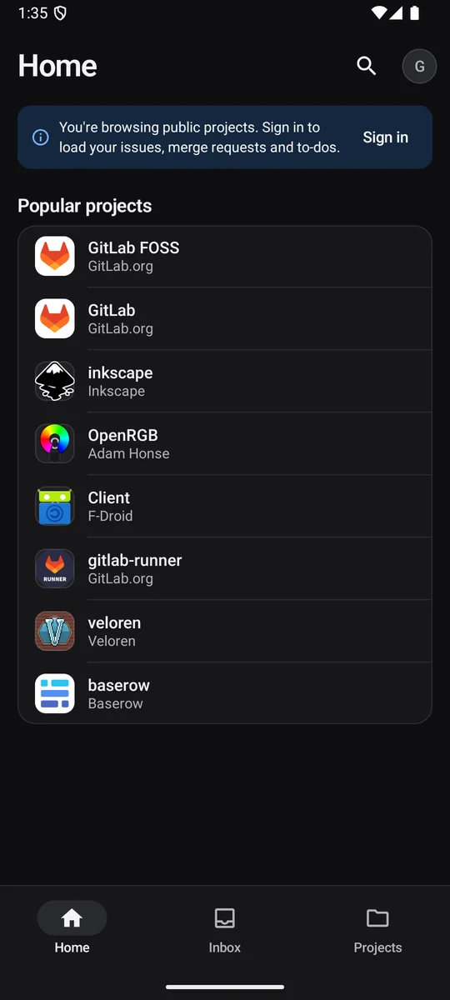
  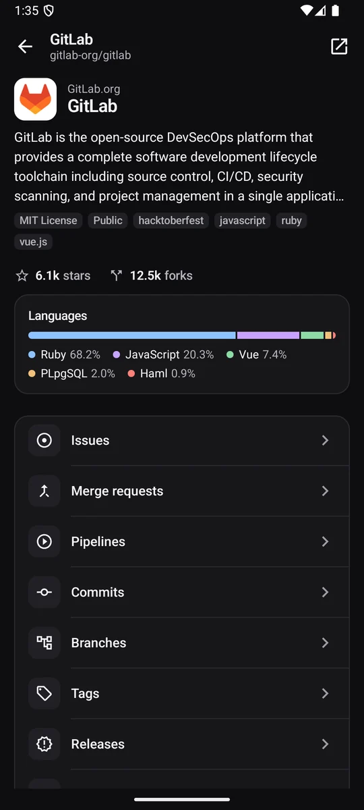
  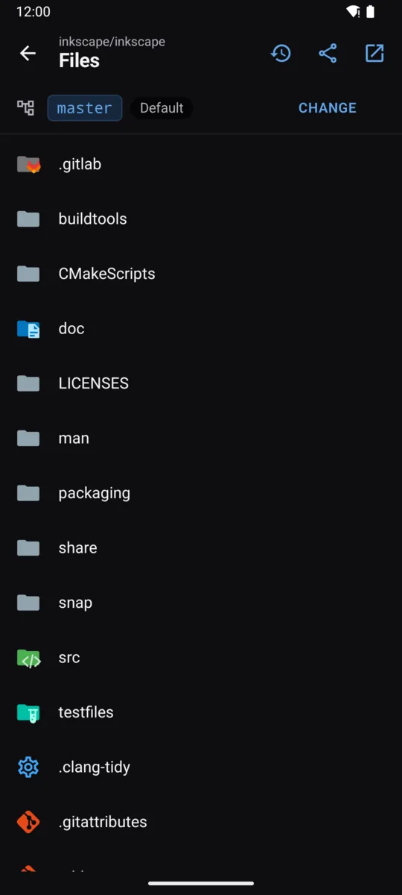
  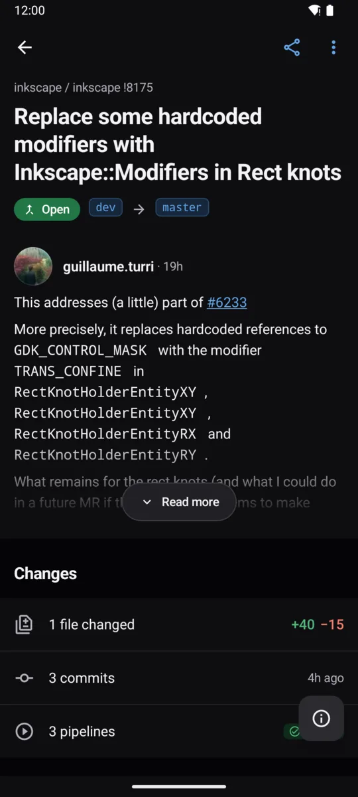
</p>

## Features

**Home and navigation**
- Three tabs: Home, Projects and Inbox
- Home lists your work (issues, merge requests, pipelines, your projects, groups), your starred projects as favorites and your recent activity
- As a guest: popular public projects on GitLab.com and a banner that offers to sign in

**Projects and code**
- Project page in the manner of a GitHub repository: name, visibility, stars and forks, topics, star/fork/clone actions, then Issues, Merge requests, Pipelines, Releases (with the latest one), Contributors, the current branch, Code, Commits, Branches and Tags
- Exact open issue and merge request counts, and pull to refresh
- Rendered README (GitLab Flavored Markdown: tables, task lists, code blocks, images, badges, emoji)
- Code browser with branch and tag switching, breadcrumbs and file and folder icons from Material Icon Theme
- File viewer with syntax highlighting, line numbers, wrapped lines, Markdown preview and images; tap lines to select a range and share a link to it or copy it
- Commits, branches, tags, releases (with notes and assets), contributors and project activity

**Merge requests and issues**
- Lists with dropdown filters, colored labels (including scoped labels), comment counts and pipeline status
- Issue page with its timeline: comments, label changes and other events, plus a details sheet (assignees, labels, milestone, due date, weight, time tracking)
- Create merge requests between branches with searchable source and target selection
- Merge request page with source and target branches, a folding description, Changes (files, commits, pipelines), Status (approvals, pipeline, whether it can merge) and Conversation
- Grouped discussion threads and replies, with highlighted diff context from the original revision, a comments/activity filter and a quick jump to comments
- Files changed view with sticky file headers, hunk headers, syntax highlighting, additions and deletions down to the changed words, and files you can mark as viewed
- Searchable file navigation and saved diff preferences: wrapping, line numbers, syntax colors and font size
- Markdown editor with a formatting toolbar and live preview for comments, descriptions and new issues
- Merge, close, reopen, comment and edit when signed in

**CI/CD**
- Pipelines across your projects and per project, with stages
- Pipeline detail with jobs grouped by stage; running pipelines refresh on their own
- Job detail with the log rendered in color (ANSI), collapsed section markers and a jump to the end
- Retry pipelines and jobs, cancel running pipelines

**Everything else**
- Inbox for GitLab to-dos, with filters and mark as done
- Global search for projects, issues, merge requests and people
- User profiles with status, links, followers and profile README; groups with subgroups and projects
- GitLab links inside Markdown open the matching screen in the app
- Several accounts side by side, on GitLab.com or your own servers; switch from your profile
- Light and near-black dark themes, reduced-motion support, 48dp touch targets and screen-reader labels throughout

## Screenshots

| Light | Dark |
| --- | --- |
| 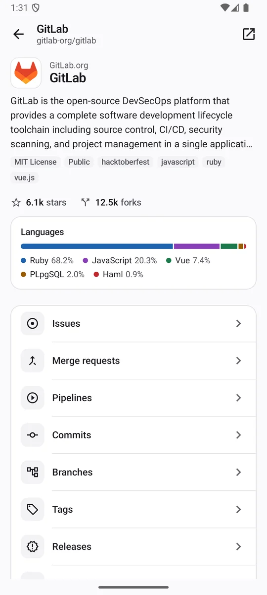 |  |
| 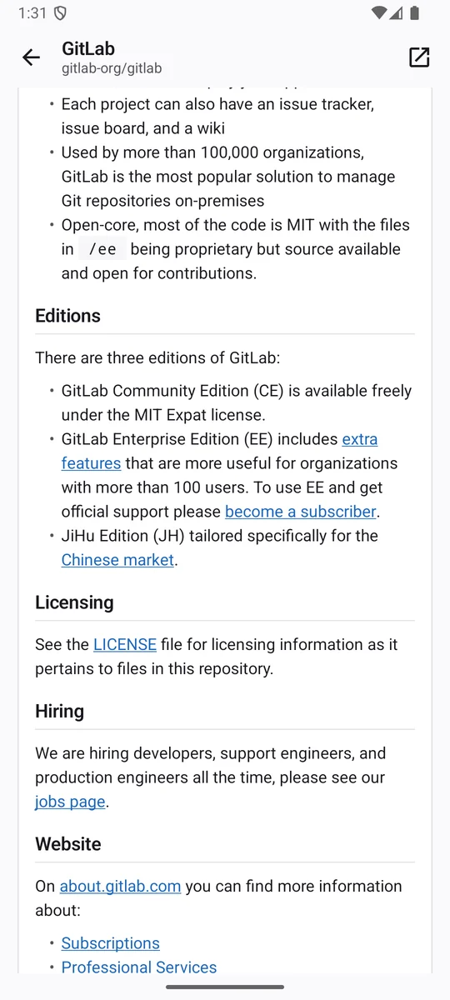 | 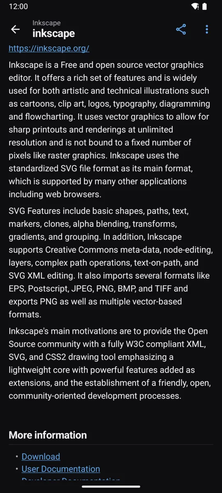 |
| 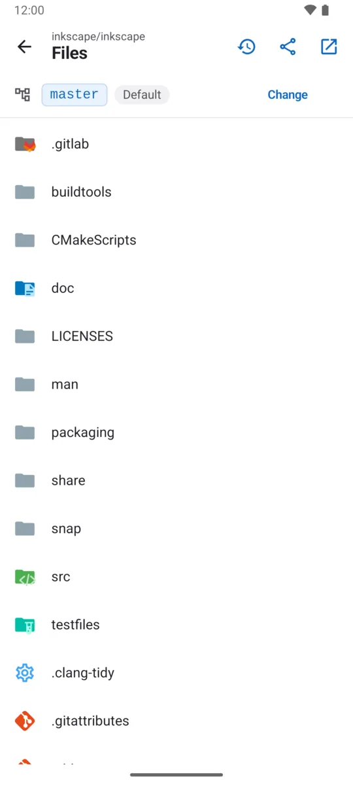 |  |
| 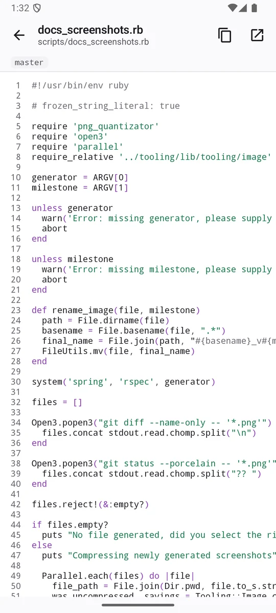 | 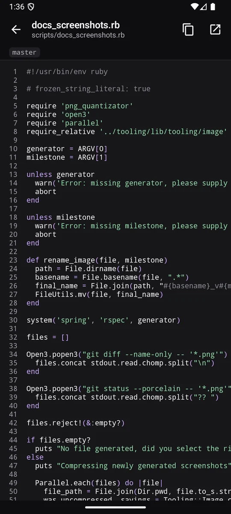 |
| 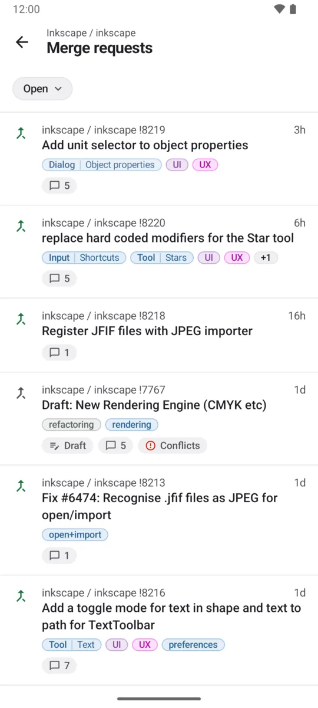 | 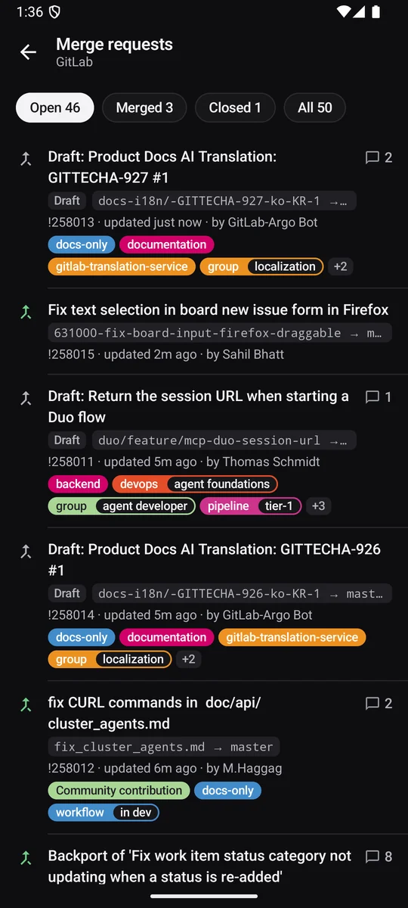 |
| 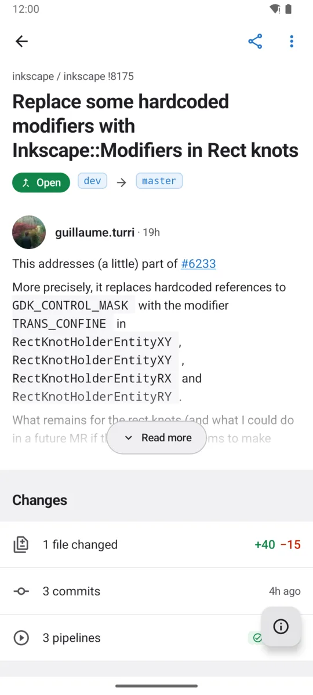 |  |
| 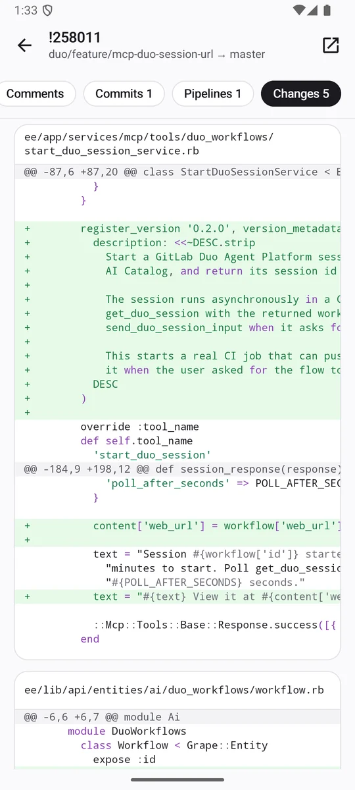 | 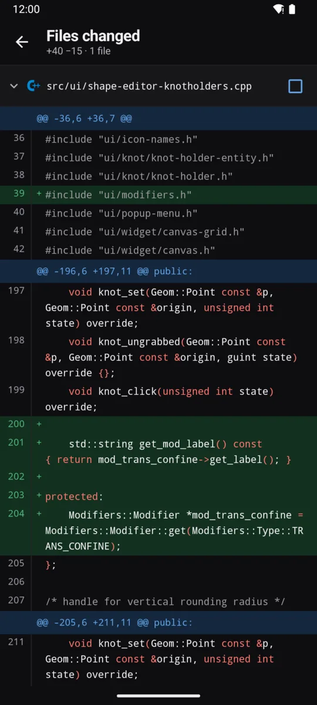 |
| 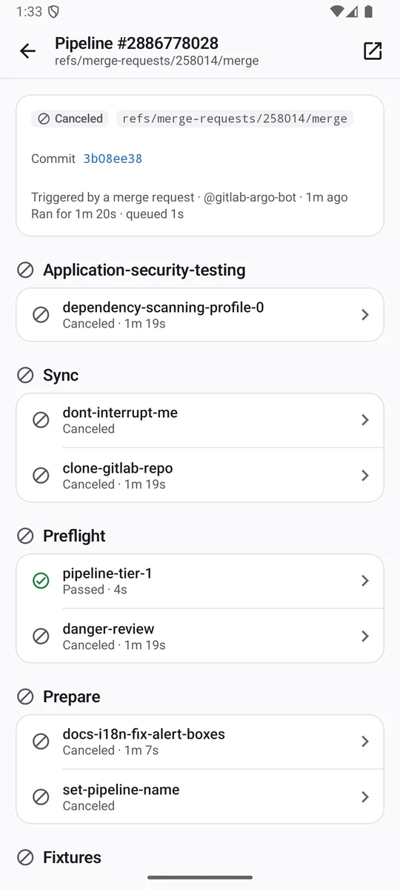 | 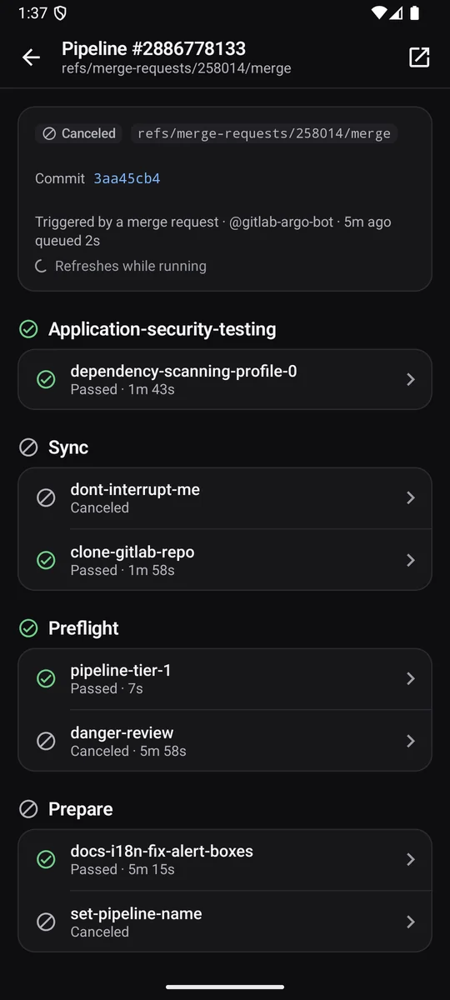 |
| 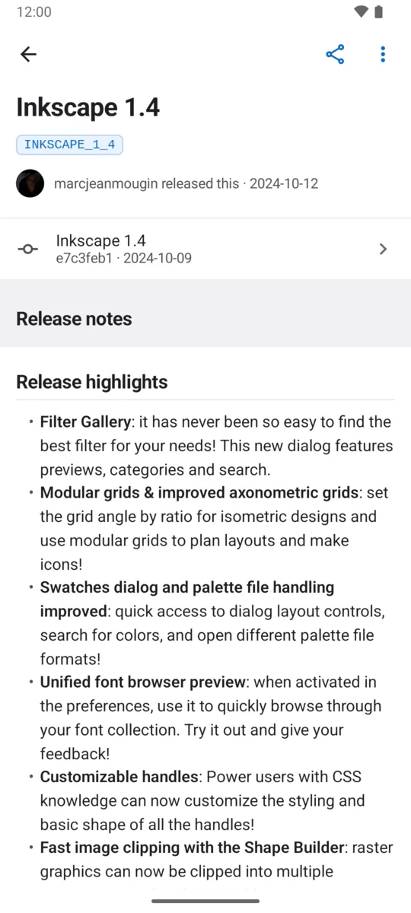 | 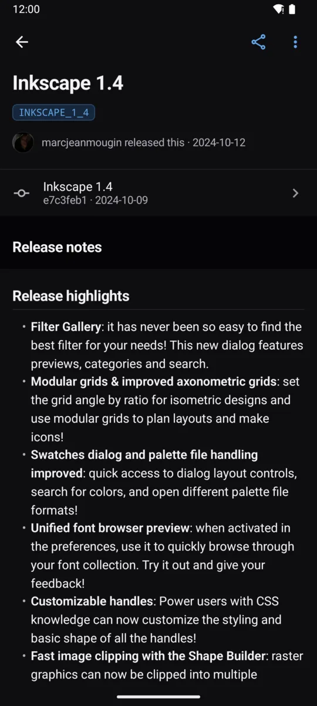 |

All screenshots show public projects on GitLab.com (mostly Inkscape), browsed as a guest.

## Signing in

Without an account the app opens as a guest on GitLab.com: public projects, code, issues, merge requests and pipelines can be read, nothing can be changed, and a banner offers to sign in. Signing in replaces the guest mode; signing out of the last account returns to it.

| Method | When to use it |
| --- | --- |
| **Access token** | Any server. Create a personal access token with the `api` scope under *Preferences → Access tokens* (`read_api` is enough to browse). |
| **OAuth** | Servers where you can register an application: non-confidential, `api` scope, redirect URI `com.cboyxd.gitlab://oauth`. Works with SSO. Tokens refresh automatically. |
| **Password** | Servers that allow password sign-in. The app creates a personal access token for itself. Supports two-factor codes. |

Credentials are encrypted with a key held in Android Keystore and never leave the device except as the auth header to the server you added. Backups are disabled for the app.

Project and group avatars use authenticated API download endpoints. On servers that restrict public visibility, uploaded user avatars may remain unavailable: GitLab's web image routes require a browser session and do not accept API tokens. The app keeps an initial for these images.

## Architecture

- **UI:** Jetpack Compose with a small design system (`ui/theme`, `ui/components`): semantic color tokens with GitLab's status and accent colors, colored navigation tiles, a named type scale, motion tokens that respect *Remove animations*.
- **State:** one `GitLabViewModel` owning a `StateFlow<GitLabUiState>`, split into features (`ProjectFeature`, `ReviewFeature`, `PipelineFeature`, `ExploreFeature`). Every section is a `Loadable` with its own loading, error and empty states.
- **Sessions:** all network work runs in a coroutine scope tied to the active server and is cancelled when you switch servers, so a slow response from one server never lands in another's screens.
- **Networking:** Retrofit and OkHttp on a single shared client. Lists are paged with hard limits (the app never walks a whole history), cancellation always propagates, and expired OAuth tokens are refreshed once under a mutex with a retry.
- **Markdown:** parsed with `org.jetbrains:markdown` (GFM) and rendered natively; highlighting uses `dev.snipme:highlights`, both off the main thread.
- **File icons:** SVGs from Material Icon Theme in `assets/file-icons`, drawn with AndroidSVG, parsed off the main thread and cached.

## Building

Requirements: JDK 17+, Android SDK 36.

```bash
./gradlew :app:assembleDebug          # build
./gradlew :app:testDebugUnitTest      # unit and UI tests (MockWebServer, Robolectric)
./gradlew :app:recordRoborazziDebug   # re-record the screenshot tests
./gradlew :app:installDebug           # install on a connected device or emulator
```

The tests cover the API layer (pagination limits, cancellation, JSON null handling, project counts, token parsing, error messages), guest mode and saved accounts, file-icon lookup (and that every shipped icon renders), Markdown parsing and the editor, and the main screens in Compose: Home, accounts, project page, code browser and file viewer with line selection, issue and merge request lists and pages. Screenshot tests record Home and the project page in both themes.

## Credits

File and folder icons are a curated subset of [Material Icon Theme](https://github.com/material-extensions/vscode-material-icon-theme) (MIT, license in `app/src/main/assets/file-icons/LICENSE`). Refresh them with `tools/update_file_icons.py`; the popular set it keeps is listed at the top of that script.

Code and job logs use bundled [Liberation Mono](https://github.com/liberationfonts/liberation-fonts) (SIL Open Font License, license in `app/src/main/assets/licenses/liberation-mono.txt`).

## License

No license has been chosen yet, so default copyright applies. Add a `LICENSE` file before accepting contributions.
